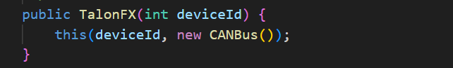

# Create IntakeIOTalonFX

## What you'll need

* [ ] A computer with WPILib installed
* [x] Internet connection
* [ ] The modified AdvantageKit\_TalonFXSwerveTemplate robot code

## 1. Add a new class IntakeIOTalonFX

Setting up IntakeIOTalonFX class using IntakeIO interface is the same as setting up IntakeIOSim. Open WPILib VS Code and open AdvantageKit\_TalonFXSwerveTemplate.

Open src >> main >> java >> frc >> robot >> subsystems >> intake.

Right click the folder intake >> Create a new class/command

<figure><figcaption></figcaption></figure>

The Command Center prompts you to Pick a command. We want to select the command:


```
Empty Class Create an empty class
```


<figure><figcaption></figcaption></figure>

The Command Center prompts you to Please enter a class name. Type in IntakeIOTalonFX and press enter.


```java
// Copyright (c) FIRST and other WPILib contributors.
// Open Source Software; you can modify and/or share it under the terms of
// the WPILib BSD license file in the root directory of this project.

package frc.robot.subsystems.intake;

/** Add your docs here. */
public class IntakeIOTalonFX {}
```


Make sure the class `implements IntakeIO` and add the empty methods as well.


```java
// Copyright (c) FIRST and other WPILib contributors.
// Open Source Software; you can modify and/or share it under the terms of
// the WPILib BSD license file in the root directory of this project.

package frc.robot.subsystems.intake;

/** Add your docs here. */
public class IntakeIOTalonFX implements IntakeIO {

  @Override
  public void updateInputs(IntakeIOInputs inputs) {}

  @Override
  public void setIntakeVoltage(double voltage) {}
}
```


## 2. Add variables

We add two private variables. VS Code will let you know you need to make some imports for the code to work.

<pre class="language-java" data-overflow="wrap"><code class="lang-java">// Copyright (c) FIRST and other WPILib contributors.
// Open Source Software; you can modify and/or share it under the terms of
// the WPILib BSD license file in the root directory of this project.

package frc.robot.subsystems.intake;

<strong>import com.ctre.phoenix6.hardware.TalonFX;
</strong><strong>import com.ctre.phoenix6.controls.VoltageOut;
</strong>
/** Add your docs here. */
public class IntakeIOTalonFX implements IntakeIO {
  
<strong>  private final TalonFX intakeTalon;
</strong><strong>  private final VoltageOut request; 
</strong>  
  @Override
  public void updateInputs(IntakeIOInputs inputs) {}

  @Override
  public void setIntakeVoltage(double voltage) {}
}
</code></pre>

What are data types of these variables?

Control + click on `TalonFX` (or `VoltageOut`). Notice it opens up a class.\
These variables are called **reference variables** and they contain an object.&#x20;

`intakeTalon` contains a `TalonFX` object created from the `TalonFX` class. `intakeTalon` controls the motor and internal sensors (such as a Kraken X60 or Falcon 500).

`request` contains a `VoltageOut` object created from the `VoltageOut` class. `request` tells the motor controller what voltage to run at.


To be more accurate the reference variables don't actually contain the object. The reference variables are used to access (or refer to) the object that we will eventually make (we haven't made the object for the reference variable to point to yet).

Think of it like a TV with no buttons (object) and a remote control (reference variable). We have to access the TV (object) through the remote control (reference variable).


### Code breakdown #1&#x20;

<details>

<summary><code>final</code></summary>

`final` prevents a variable from referring to a different object after the value is assigned.

`intakeTalon` will only ever refer to the `TalonFX` object we eventually assign. This is important to make sure `intakeTalon` isn't messing with for example the drive subsystem's motor objects.

You can also use `final` to prevent a variable from changing value. Here is an example creating a constant int (remember "=" means "is changed to the value of")


```java
private final int MAX_VOLTAGE = 12;
```


`MAX_VOLTAGE` will always be 12 and trying to change its value will give us an error when we try to build the code.

</details>

## 3. Add class constructor & create objects

We add a class constructor to the class.&#x20;

<pre class="language-java" data-overflow="wrap"><code class="lang-java">// Copyright (c) FIRST and other WPILib contributors.
// Open Source Software; you can modify and/or share it under the terms of
// the WPILib BSD license file in the root directory of this project.

package frc.robot.subsystems.intake;

import com.ctre.phoenix6.hardware.TalonFX;
import com.ctre.phoenix6.controls.VoltageOut;

/** Add your docs here. */
public class IntakeIOTalonFX implements IntakeIO {
  
  private final TalonFX intakeTalon;
  private final VoltageOut request; 
  
<strong>  public IntakeIOTalonFX() {
</strong><strong>    intakeTalon = new TalonFX(5);
</strong><strong>    request = new VoltageOut(0.0);
</strong><strong>  }
</strong>  
  @Override
  public void updateInputs(IntakeIOInputs inputs) {}

  @Override
  public void setIntakeVoltage(double voltage) {}
}
</code></pre>

### Code breakdown #2&#x20;

<details>

<summary>What is a class constructor?</summary>

A class constructor is a special method that runs once when an object is created from the class.

Every time a new object is created using the class Intake, we call the Intake class constructor once.

The value of the variable `io` inside of `Intake` is set to the value of the parameter `IntakeIO io` we put in while making a new `Intake` object (which is going to be `IntakeIOSim()` or `IntakeIOTalonFX()`).

Later we will be making the Intake object in RobotContainer.java.

</details>

We have made some objects for the reference variables to point to. Let's look at this line of code:


```java
intakeTalon = new TalonFX(5);
```


* `intakeTalon`: the empty reference variable we created earlier
* `=`: "is changed to the value of". Now `intakeTalon` isn't empty anymore.
* `new`: just a necessary thingy to make an object
* `TalonFX(5)`: Classes (and therefore objects) can have parameters like methods!
  *   Control + click on `TalonFX`. We can see in the class constructor of `TalonFX` that it needs an int parameter.<br>

      
  *   VS Code might try to add some helpful inlay hints in grey that give us some information about each parameter we need to add to the object. You can't delete this text, but you can disable it if it's distracting.<br>

      .png>)



There are always several motors on an FRC robot. Our robot might have a drive train subsystem, an Intake subsystem, an Elevator subsystem and Arm subsystem.&#x20;

How do we control these motors?

Every FRC robot is controlled by the RoboRIO (computer brain) which is connected to the motor controllers, sensors and electronics in a loop of wires called a CAN Bus (Controller Area Network).

FRC robots only got one loop (so if one thing in the loop breaks the entire robot goes down).&#x20;

If we have multiple motors on a single loop of wires (a single CAN Bus), how do we know which motor is which?

Each motor gets its own unique int called a CAN ID (deviceID) so we know exactly which motor we are controlling.



There are always several motors on an FRC robot. Our robot might have a drive train subsystem, an Intake subsystem, an Elevator subsystem and Arm subsystem.&#x20;

How do we control these motors?

Every FRC robot is controlled by the Systemcore (computer brain) which is connected to the motor controllers, sensors and electronics in a loop of wires called a CAN Bus (Controller Area Network).

Previously FRC robots only got one loop (so if one thing in the loop broke the entire robot goes down) Now we have the option of multiple separate CAN channels. We might put the drivetrain on one CAN Bus and put the other subsystems on another CAN Bus. We might put everything on one CAN Bus.

If we have multiple motors on a CAN Bus, how do we know which motor is which?

Each motor gets its own unique int called a CAN ID (deviceID) so we know exactly which motor we are controlling.



<details>

<summary>What is Output?</summary>

Control + Click on `VoltageOut`. Scroll to the very top of the file.The person who already wrote this code left us some notes about this variable (condensed here for brevity)


```java
/**
 * Voltage to attempt to drive at
 * Units: Volts
 */
public double Output;
```


So this is a `double` and the voltage of the motor tries to match the decimal in this variable.

Scroll down to the class constructor of `VoltageOut`&#x20;


There is more than one class constructor here. We want the one with the `double` parameter not the `Voltage` parameter



```java
public VoltageOut(double Output) {
    this.Output = Output;
}
```


Look back at our IntakeIOTalonFX code where we created an object:


```java
request = new VoltageOut(0.0);
```


That `0.0` we assign is going into the class constructor and changing the `request` object's variable `Output` (the voltage the motor controller is trying to match) to `0.0`.


```java
public VoltageOut(double 0.0) {
    Output = 0.0; //the object's variable is changed to 0.0
}
```


</details>

## 4. Fill in the setIntakeVoltage method

Start with the second method `setIntakeVoltage`.

<pre class="language-java" data-overflow="wrap"><code class="lang-java">// Copyright (c) FIRST and other WPILib contributors.
// Open Source Software; you can modify and/or share it under the terms of
// the WPILib BSD license file in the root directory of this project.

package frc.robot.subsystems.intake;

import com.ctre.phoenix6.hardware.TalonFX;
import com.ctre.phoenix6.controls.VoltageOut;

/** Add your docs here. */
public class IntakeIOTalonFX implements IntakeIO {
  
  private final TalonFX intakeTalon;
  private final VoltageOut request; 
  
  public IntakeIOTalonFX() {
    intakeTalon = new TalonFX(5);
    request = new VoltageOut(0.0);
  }
  
  @Override
  public void updateInputs(IntakeIOInputs inputs) {}

  @Override
  public void setIntakeVoltage(double voltage) {
<strong>    request.Output = voltage;
</strong><strong>    intakeTalon.setControl(request);
</strong>  }
}
</code></pre>

### Code Breakdown #3

<details>

<summary><code>.</code> the member access operator</summary>

The period `.` is used to access anything inside an object. We can access an object's variables and methods.


```java
objectName.variableInsideOfObject; // get this
```


</details>

<details>

<summary><code>.</code> + <code>()</code> the member call operator</summary>

We tell the computer to do some code aka call the method


```java
objectName.methodName(methodParameter); // do this
```


</details>

### Update the request object

Inside of the class constructor, we created a `VoltageOut` object and set `request` to refer to that `VoltageOut` object.


```java
request = new VoltageOut(0.0);
```


Using Control + click, we looked inside of the class `VoltageOut` to see that there is a variable called `Output`. We can access the variable `Output` inside our object `request` by using `request.Output`.


Remember "=" means "is changed to the value of"


Look back at the line we added to `updateInputs()`


```java
request.Output = voltage;
```


`voltage` is the parameter that we put into our method `setIntakeVoltage`\
What we have done is updated the value of the variable `Output` inside of our object `request` to the value `voltage`

### Use the VoltageOut object to control the motor

`intakeTalon` is the object we made using `TalonFX` class. One of the `TalonFX` class methods is `setControl`.

We can control + click on `TalonFX` to see the comments of the person who wrote this code. They explain what the `setControl` method does.


```
Request a specified voltage. This control mode will attempt to apply the specified voltage to the motor. If the supply voltage is below the requested voltage, the motor controller will output the supply voltage.
```



```java
intakeTalon.setControl(request);
```


This line of code will change the voltage of the `TalonFX` object `intakeTalon` to the voltage of the voltage inside the object `request` (which we just updated in the line above)

### Why not do this?

<pre class="language-java" data-overflow="wrap"><code class="lang-java">// Copyright (c) FIRST and other WPILib contributors.
// Open Source Software; you can modify and/or share it under the terms of
// the WPILib BSD license file in the root directory of this project.

package frc.robot.subsystems.intake;

import com.ctre.phoenix6.hardware.TalonFX;
<strong>// import com.ctre.phoenix6.controls.VoltageOut; remove this
</strong>
/** Add your docs here. */
public class IntakeIOTalonFX implements IntakeIO {
  
  private final TalonFX intakeTalon;
<strong>  // private final VoltageOut request; remove this
</strong>  
  public IntakeIOTalonFX() {
    intakeTalon = new TalonFX(5);
<strong>    // request = new VoltageOut(0.0); remove this
</strong>  }
  
  @Override
  public void updateInputs(IntakeIOInputs inputs) {}

  @Override
  public void setIntakeVoltage(double voltage) {
<strong>    // request.Output = voltage; remove this
</strong><strong>    intakeTalon.setControl(voltage); // change this
</strong>  }
}
</code></pre>

We can see what kind of parameter the method `setControl` needs with control +click.

.png>)

The parameter of the method `setControl` needs to be a `VoltageOut` object. Remember the variable `voltage` is a double (a decimal number) We can't put a raw number into the parameter of the method `setControl`. It needs to be a `VoltageOut` object.

### Or why not do this?

<pre class="language-java" data-overflow="wrap"><code class="lang-java">// Copyright (c) FIRST and other WPILib contributors.
// Open Source Software; you can modify and/or share it under the terms of
// the WPILib BSD license file in the root directory of this project.

package frc.robot.subsystems.intake;

import com.ctre.phoenix6.hardware.TalonFX;
import com.ctre.phoenix6.controls.VoltageOut;

/** Add your docs here. */
public class IntakeIOTalonFX implements IntakeIO {
  
  private final TalonFX intakeTalon;
<strong>  // private final VoltageOut request; remove this
</strong>  
  public IntakeIOTalonFX() {
    intakeTalon = new TalonFX(5);
<strong>    // request = new VoltageOut(0.0); remove this
</strong>  }
  
  @Override
  public void updateInputs(IntakeIOInputs inputs) {}

  @Override
  public void setIntakeVoltage(double voltage) {
<strong>    // request.Output = voltage; remove this
</strong><strong>    intakeTalon.setControl(new VoltageOut(voltage)); // change this
</strong>  }
}
</code></pre>

This code does the same thing, but instead of reusing an object (which we called `request`) and changing the value of `Output`, we are creating a new object every time with the value of `Output` inside of the new object set to `voltage`.

Yes, you can do this instead but this is making a new object over and over again, which is not efficient. The robot will start slowing down if you have too much garbage).&#x20;

We should create a single `VoltageOut` object, update its value, and use that object to change the `TalonFX` object.

## 5. Fill in the updateInputs method

We need some imports for the methods we write inside of the method.

<pre class="language-java" data-overflow="wrap"><code class="lang-java">// Copyright (c) FIRST and other WPILib contributors.
// Open Source Software; you can modify and/or share it under the terms of
// the WPILib BSD license file in the root directory of this project.

package frc.robot.subsystems.intake;

import com.ctre.phoenix6.hardware.TalonFX;
import com.ctre.phoenix6.controls.VoltageOut;

<strong>import static edu.wpi.first.units.Units.Radians;
</strong><strong>import static edu.wpi.first.units.Units.RadiansPerSecond;
</strong><strong>import static edu.wpi.first.units.Units.Amps;
</strong>
/** Add your docs here. */
public class IntakeIOTalonFX implements IntakeIO {
  
  private final TalonFX intakeTalon;
  private final VoltageOut request; 
  
  public IntakeIOTalonFX() {
    intakeTalon = new TalonFX(5);
    request = new VoltageOut(0.0);
  }
  
  @Override
  public void updateInputs(IntakeIOInputs inputs) {
<strong>    inputs.intakePositionRadians = intakeTalon.getPosition().getValue().in(Radians); 
</strong><strong>    inputs.intakeVelocityRadiansPerSec = intakeTalon.getVelocity().getValue().in(RadiansPerSecond);
</strong><strong>    inputs.intakeAppliedVoltage = intakeTalon.getMotorVoltage().getValueAsDouble();
</strong><strong>    inputs.intakeCurrentAmperage = intakeTalon.getSupplyCurrent().getValue().in(Amps);
</strong>  }

  @Override
  public void setIntakeVoltage(double voltage) {
    request.Output = voltage;
    intakeTalon.setControl(request);
  }
}
</code></pre>

This looks like a whole lot, so start with `inputs.intakeAppliedVoltage`

<pre class="language-java" data-overflow="wrap"><code class="lang-java"><strong>inputs.intakeAppliedVoltage = intakeTalon.getMotorVoltage().getValueAsDouble();
</strong></code></pre>

What is this code doing?

The code is read from left to right. so we start with `inputs`. First we grab `intakePositionAppliedVoltage` from inside `inputs`, which has the value `IntakeIOInputs`.&#x20;

Remember that `IntakeIOInputs` is the static nested class we made inside of IntakeIO.java:

```java
public static class IntakeIOInputs {
  public double intakePositionRadians = 0.0;
  public double intakeVelocityRadiansPerSeconds = 0.0;
  public double intakeAppliedVoltage = 0.0;
  public double intakeCurrentAmperage = 0.0;
}
```


By using `inputs.intakeAppliedVoltage`, we can get the double `intakeAppliedVoltage` inside of `IntakeIOInputs`&#x20;


`=` means "is changed to the value of"


`intakeTalon` is the TalonFX object, and we want to use the method inside of `intakeTalon` called `getMotorVoltage()`.

Control + click on `getMotorVoltage()` so we can learn more about this method.

.png>)

We learned one of the components of a method is its **return type**. So far we've seen mostly `void` as the return type, which means it doesn't return anything.

The method `getMotorVoltage()` will return something called a `StatusSignal<Voltage>`

When we use the method `getMotorVoltage()`, we will get a `StatusSignal<Voltage>` that has information about the motor's voltage value.

Control + click on `getValueAsDouble()`.

.png>)

We can see that the **return type** of `getValueAsDouble()` is `double`.

The value of the `double` that the method `getValueAsDouble()` returns is the variable `baseValue`. `baseValue` must be a `double` because `getValueAsDouble()` has to return a `double` value. Sure enough if you look further up in the file:

.png>)

(`protected` is an **access modifier** kinda between **public** and **private**)

Another way to look at the line of code:


```java
StatusSignal<Voltage> voltageStatusTemporaryVariable = intakeTalon.getMotorVoltage();
double voltageValueTemporaryVariable = voltageStatusTemporaryVariable.getValueAsDouble();
inputs.intakeAppliedVoltage = voltageValueTemporaryVariable;
```


Breakdown example of another line of code: `intakePositionRadians`


```java
StatusSignal<Angle> angleStatusTemp = intakeTalon.getPosition();
Angle angleObjectTemp = angleStatusTemp.getValue();
double radiansValueTemp = angleObjectTemp.in(Radians);
inputs.intakePositionRad = radiansValue; 
```


By writing all of this in one line of code we save time figuring out more lines of code AND we create less objects for the computer to make (optimization!)

## 6. Completed IntakeIOTalonFX.java


```java
// Copyright (c) FIRST and other WPILib contributors.
// Open Source Software; you can modify and/or share it under the terms of
// the WPILib BSD license file in the root directory of this project.

package frc.robot.subsystems.intake;

import com.ctre.phoenix6.hardware.TalonFX;
import com.ctre.phoenix6.controls.VoltageOut;

import static edu.wpi.first.units.Units.Radians;
import static edu.wpi.first.units.Units.RadiansPerSecond;
import static edu.wpi.first.units.Units.Amps;

/** Add your docs here. */
public class IntakeIOTalonFX implements IntakeIO {
  
  private final TalonFX intakeTalon;
  private final VoltageOut request; 
  
  public IntakeIOTalonFX() {
    intakeTalon = new TalonFX(5);
    request = new VoltageOut(0.0);
  }
  
  @Override
  public void updateInputs(IntakeIOInputs inputs) {
    inputs.intakePositionRadians = intakeTalon.getPosition().getValue().in(Radians); 
    inputs.intakeVelocityRadiansPerSec = intakeTalon.getVelocity().getValue().in(RadiansPerSecond);
    inputs.intakeAppliedVoltage = intakeTalon.getMotorVoltage().getValueAsDouble();
    inputs.intakeCurrentAmperage = intakeTalon.getSupplyCurrent().getValue().in(Amps);
  }

  @Override
  public void setIntakeVoltage(double voltage) {
    request.Output = voltage;
    intakeTalon.setControl(request);
  }
}
```

